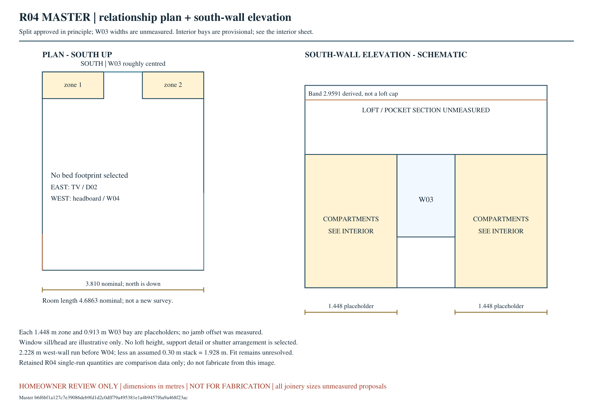
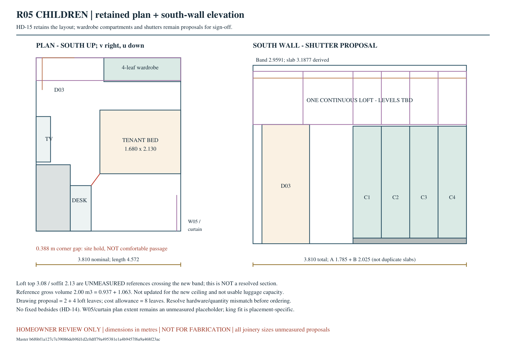
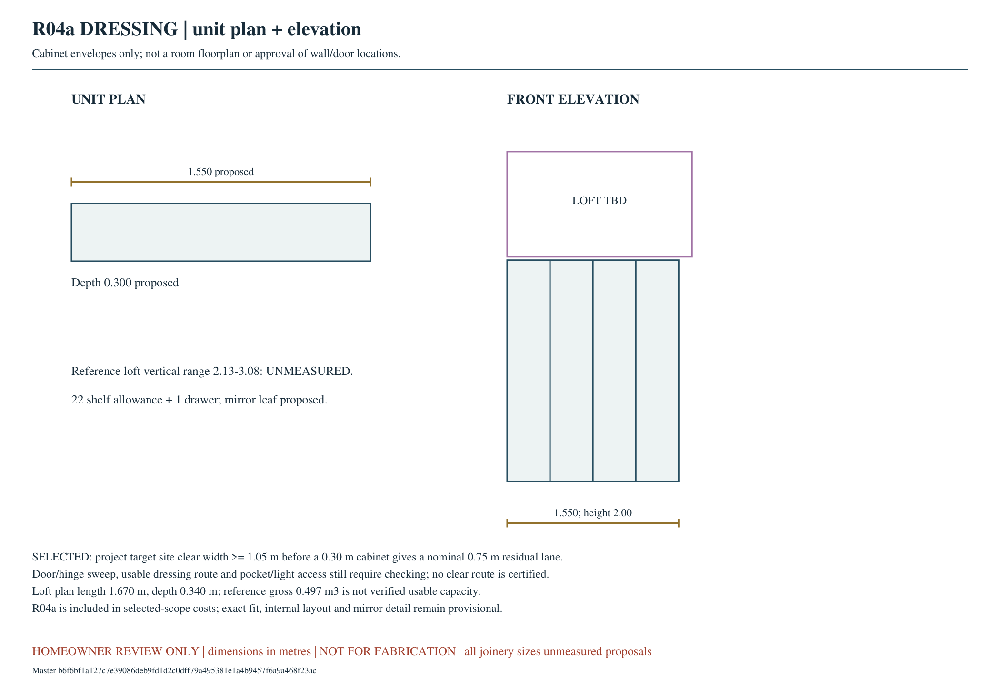
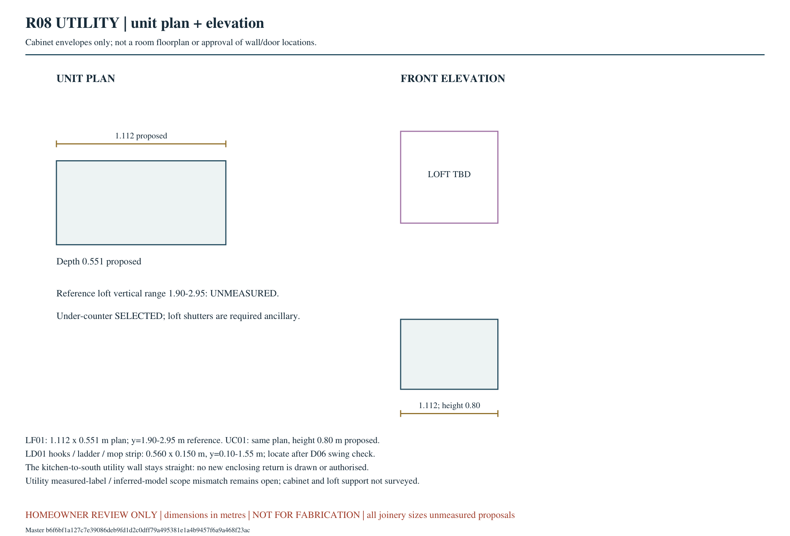
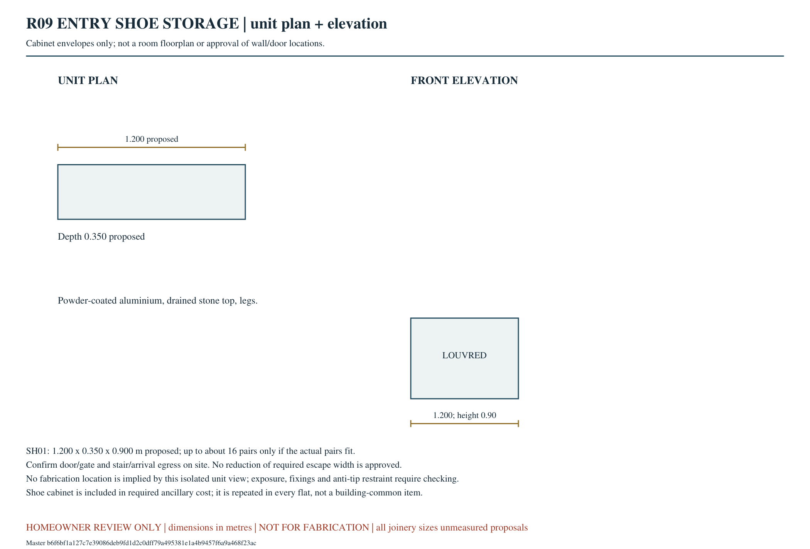
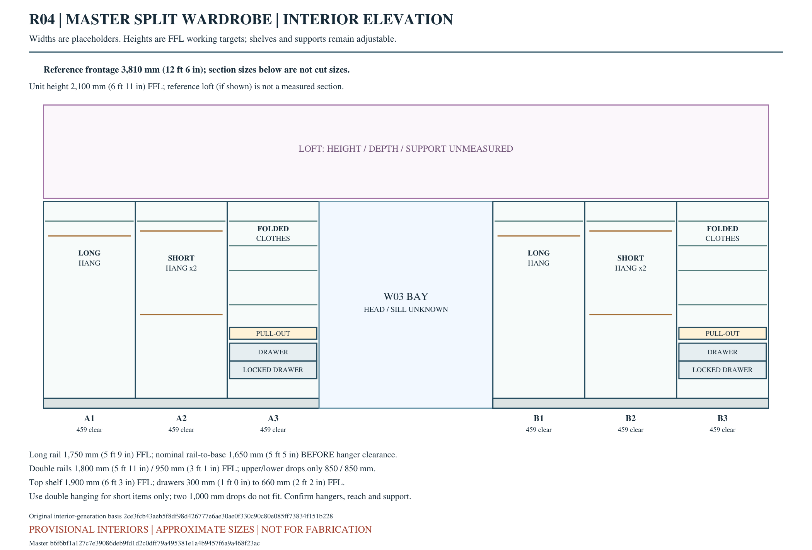
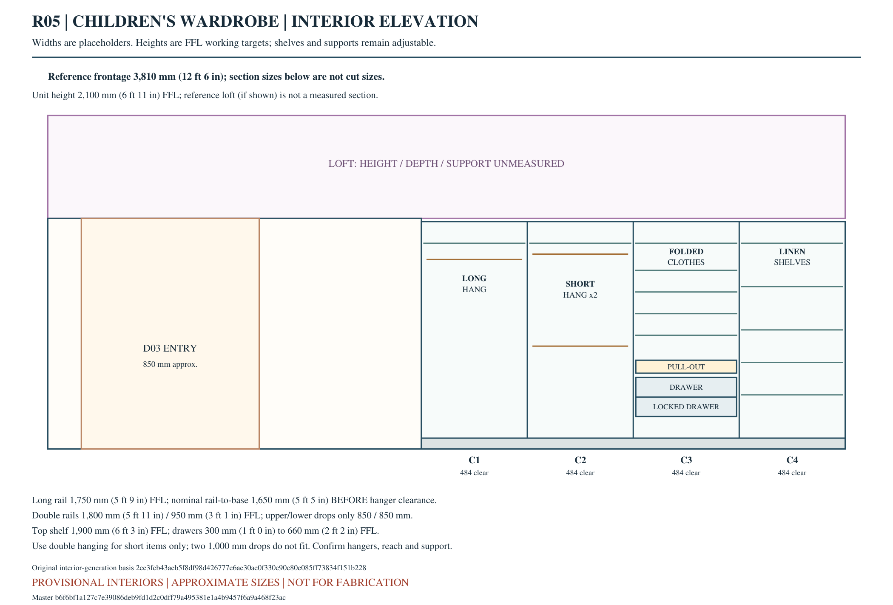
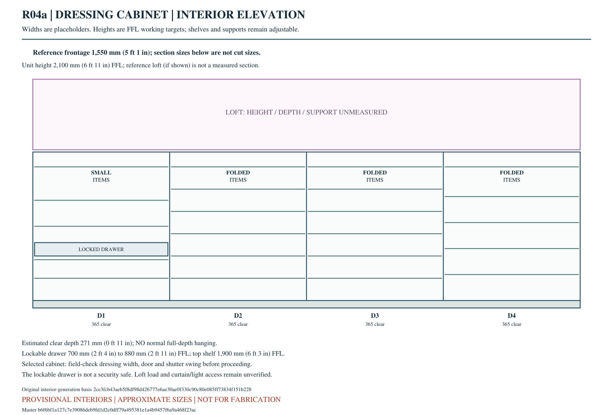
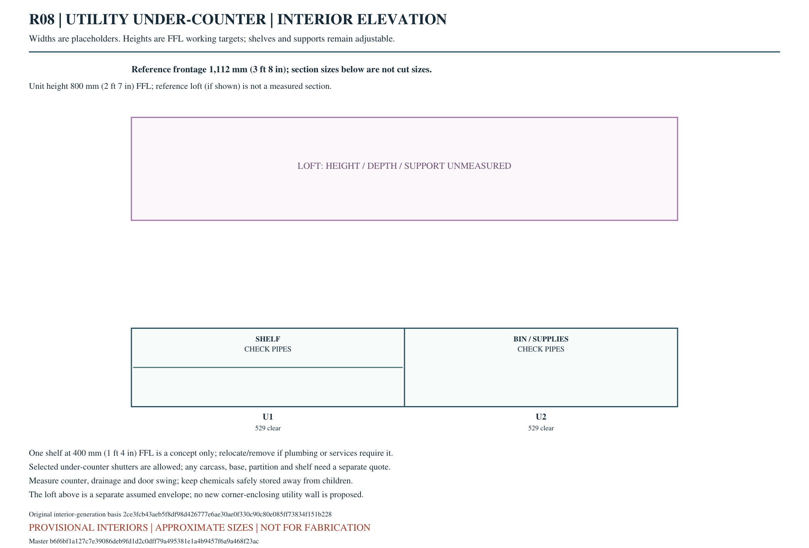
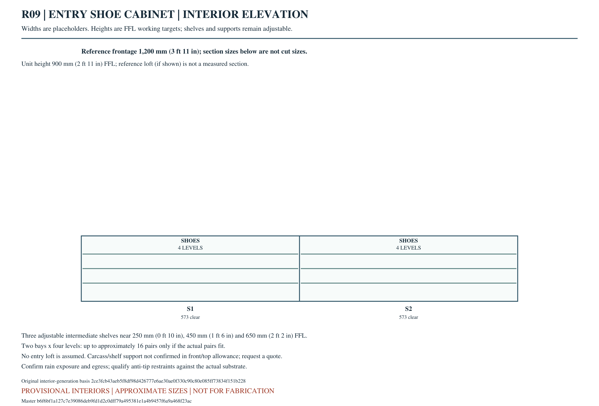

# Wardrobe and storage - homeowner sign-off pack

**Ready for review, NOT for fabrication.** This pack records confirmed choices, material recommendations and remaining decisions; it does not approve joinery shop drawings.

**Source master SHA-256:** `b6f6bf1a127c7e39086deb9fd1d2c0dff79a495381e1a4b9457f6a9a468f23ac`. Four identical rental flats in Hyderabad. This is a coordination handoff, not permission to fabricate.

**Original interior-generation basis:** `2ce3fcb43aeb5f8df98d426777e6ae30ae0f330c90c80e085ff73834f151b228`; immutable interior JSON SHA-256 `0e6cafd94960eacb3ee1e38533f985adc31f57829c574506eeb5db73c281048d`. The current master adds a guarded source reference only; existing geometry, decisions and holds are unchanged. The original interior source has not been relabelled as generated from the newer master.

## 1. Already confirmed - do not ask again

| Topic | Current rule |
|---|---|
| Household / floors | Four flats; typical family of 3-4, a couple plus one or two children (HD-04). |
| Beds | Tenant-supplied, excluded from joinery and all costs (HD-05). |
| Fixed bedside cabinets | Omitted in BOTH bedrooms (HD-14). Not an optional add-on awaiting approval. Movable tenant tables remain possible. |
| Budget | INR 250,000-350,000 per flat, before GST, excluding beds (HD-06). Allowance rates are NOT tax-normalised. |
| Material | OPT-E BWP plywood carcass and laminate shutters selected (HS-WARDROBE-OPT-E). Base, gap and hardware details are proposed pending professional checks. |
| R04 relationship | Split wardrobe around roughly-centred W03 approved in principle (HS-MBR-SPLIT-WARDROBE); SOUTH wardrobe, WEST headboard/W04 and EAST TV/door. Exact widths are unmeasured; the interiors below are provisional. |
| R05 layout | Retained unchanged (HD-15); approximately 387.6 mm bed/study corner gap is a SITE HOLD, not a comfortable passage. |
| Dressing and utility | Homeowner selected the R04a shallow dressing cabinet (HS-R04A-CABINET) AND R08 under-counter cabinet (HS-R08-UNDERCOUNTER). Their dimensions, access and site fit remain held. |
| Curtains | Ceiling-recessed two-track sheer + blackout (HD-08/14). Pocket, support, stack and LED access need measured sections. |
| Lofts | Presence above wardrobes and in utility is homeowner-reported. R05 door-to-wardrobe continuity is confirmed; RCC material, dimensions and load capacity are NOT verified. |
| Orientation | South-up plans: north down, west right. Confirmed nominal bedroom dimensions are not newly surveyed here. |

## 2. Homeowner choices still open

| Decision | Recommendation / choices | Homeowner response |
|---|---|---|
| Proposed interiors | Review the provisional bay, hanging, drawer and pull-out layouts in section 3a and request any changes. The layouts are not yet approved for fabrication. | __________ |
| Bedroom shutter arrangement | Review after site measurement. In the children's room four hinged fronts are a provisional reference; six narrower fronts remain unselected. | __________ |
| Final quote | Approve or revise scope only after measured quantities and itemised, tax-normalised quotations are available. | __________ |

These outstanding choices do not reopen the selected OPT-E or the R04 split approval. No selection waives field holds or constitutes structural/electrical/fabrication approval.

### Site measurements and professional checks - not homeowner preference questions

Measure each flat's W03/W04/W05, doors and swings, finished floor and ceiling levels, wardrobe wall runs, curtain pockets and loft dimensions. Confirm R04 wardrobe/loft support, structural load and fixings, moisture, services and shutter access before shop drawings. The split and 1.448 m zones are not cut sizes.

In the children's bedroom, the current plan keeps the wardrobe beside the door, the bed facing the TV, and the continuous loft over the door and wardrobe. The calculated 388 mm is the closest corner-to-corner gap between the proposed bed and the study return near its foot, not a clear walkway: measure the tenant's actual bed and free passage on site. HD-15 keeps the layout; no furniture relocation is authorised.

**Contractor hold:** do not cut boards, install anchors, alter walls or order sized shutters from this pack. The joiner must issue measured shop drawings and a tax-normalised quotation; the site designer and qualified structural/electrical professionals must resolve affected support, curtain and service interfaces before work is released.

## 3. Room schedule and quantity limits

| Room | Current proposal / relationship | Dimensions and status |
|---|---|---|
| R04 master | Two SOUTH wardrobe zones around W03 | 1.448 m + 1.448 m placeholder zones, 0.630 m depth; W03 bay 0.913 m unmeasured. These are NOT replacement cabinet dimensions. |
| R04a dressing | Selected four-bay shallow cabinet, 22 shelf allowance + 1 drawer | Cabinet 1.550 x 0.300 m, y=0.10-2.10 m. Loft 1.670 x 0.340 m. Site clear-width target >=1.05 m and door/route operation must still be verified. |
| R05 wardrobe | Four provisional bays: long hang; two SHORT hang rows; folded clothes/drawers; linen | Envelope 2.025 x 0.630 x 2.100 m including 0.100 m plinth. Interiors are designed provisionally but not fabrication-approved; 12 shelf positions are shown. |
| R05 continuous loft | ONE run: A above entry/switch strip, B above wardrobe; no duplicate slab | 3.810 x 0.600 m; A length 1.785 m + B length 2.025 m. Drawing has 2+4=6 leaves, cost allowance has 8. Do not treat either as final. |
| R05 TV / desk / overhead | Retained proposed ancillary joinery | TV 1.200 x 0.380 m, y=0.40-0.65. Desk 1.200 x 0.550 m, y=0.60-0.75. Overhead 1.200 x 0.350 m, y=1.35-2.10. No desk resizing selected. |
| R08 utility | Aluminium loft shutters, hooks/ladder rail; selected louvred under-counter | Loft/UC01 plan 1.112 x 0.551 m. Loft y=1.90-2.95; UC01 height 0.80. Hook strip 0.560 x 0.150 m, y=0.10-1.55. Site/model scope conflict held. |
| R09 entry | Aluminium shoe cabinet, louvres, legs, stone drip top | 1.200 x 0.350 x 0.900 m; up to about 16 pairs only if actual pairs fit. Confirm arrival/gate/door and egress clearance. |

**All joinery dimensions above are proposed or inferred, not field-verified fabrication dimensions.** The only retained nominal bedroom measurements are R04 3.810 x 4.6863 m and R05 3.810 x 4.572 m, homeowner-confirmed but not independently checked.

**R04 capacity is NOT transferred to the split design.** Its reference single-run cost scope carries six leaves, 12 shelves, four drawers, 1.72 m long-hang and 0.86 m short-hang rail, and 1.444 m3 gross loft allowance. The provisional interior bays below are a separate design, not proof that the old quantity allowance is sufficient.

**Loft volumes are reference arithmetic only:** R05 0.937 + 1.063 = 2.000 m3 gross; R04a 0.497 m3; utility 0.597 m3. They use unmeasured reference envelopes, exclude usable-access deductions, are not revised for the current ceiling and do not establish suitcase counts or permitted loads. Bulky storage belongs in verified lofts, not the clothes compartments.

## 3a. Provisional interior design

The interior design is now laid out, not deferred. Every bay and height remains a working proposal for homeowner review and site measurement; the elevations are not fabrication drawings. Dimensions are millimetres from finished floor level (FFL); the inch equivalents are rounded.

**Hanging and reach:** estimated clear bedroom depth is 571 mm (1 ft 10 in) after assumed wall, shutter and back allowances within the 630 mm (2 ft 1 in) envelope. Long rail at 1,750 mm (5 ft 9 in) FFL gives 1,650 mm (5 ft 5 in) rail-to-plinth; subtract hanger/hook and clearance to get actual garment length. Top shelf is at 1,900 mm (6 ft 3 in). Test actual adult hangers: the R04 placeholder clear bays are only about 459 mm (1 ft 6 in) wide.

**Double hanging is deliberately for short clothes:** rails at 1,800 mm (5 ft 11 in) and 950 mm (3 ft 1 in) FFL leave 850 mm (2 ft 9 in) between rails and 850 mm (2 ft 9 in) from the lower rail to the plinth, before hanger/garment clearance. The upper rail has about 82 mm to the assumed 18 mm-thick shelf underside: verify the hanger hook and fittings. Two full 1,000 mm drops do not fit below the 1,900 mm shelf in this 2,100 mm-high reference unit; measure clothes or redesign rather than assuming they do.

**Drawers and trays:** bedroom drawer fronts are 300-660 mm (1 ft 0 in-2 ft 2 in) FFL; proposed accessory trays are 700-820 mm (2 ft 4 in-2 ft 8 in). The dressing drawer is 700-880 mm (2 ft 4 in-2 ft 11 in). Rail, drawer and shelf heights are working ergonomic targets, not codes or product specifications. Confirm reach, weight, opening clearance and hardware suitability.

| Room / bay | Clear width | Intended use | Approximate internal levels, mm FFL |
|---|---|---|---|
| R04 / A1 | 459 mm (1 ft 6 in) | Long dresses/kurtas, suits or folded sarees on smooth hangers; verify garment length. | shelves 1900; rails 1750 |
| R04 / A2 | 459 mm (1 ft 6 in) | Two rows for short shirts, blouses or kurtas; verify actual lengths. | shelves 1900; rails 1800, 950 |
| R04 / A3 | 459 mm (1 ft 6 in) | Folded clothes, two drawers and one removable pull-out tray. | shelves 1050, 1400, 1650, 1900; drawer fronts 300-480, 480-660; pull-out 700-820 |
| R04 / B1 | 459 mm (1 ft 6 in) | Long dresses/kurtas, suits or folded sarees on smooth hangers; verify garment length. | shelves 1900; rails 1750 |
| R04 / B2 | 459 mm (1 ft 6 in) | Two rows for short shirts, blouses or kurtas; verify actual lengths. | shelves 1900; rails 1800, 950 |
| R04 / B3 | 459 mm (1 ft 6 in) | Folded clothes, two drawers and one removable pull-out tray. | shelves 1050, 1400, 1650, 1900; drawer fronts 300-480, 480-660; pull-out 700-820 |
| R05 / C1 | 484 mm (1 ft 7 in) | Long uniforms, dresses or coats; adjust the rail as the child grows. | shelves 1900; rails 1750 |
| R05 / C2 | 484 mm (1 ft 7 in) | Two rows for child clothes or short shirts; actual lengths must be checked. | shelves 1900; rails 1800, 950 |
| R05 / C3 | 484 mm (1 ft 7 in) | Folded clothes, two drawers and one accessory pull-out tray. | shelves 1050, 1250, 1450, 1650, 1900; drawer fronts 300-480, 480-660; pull-out 700-820 |
| R05 / C4 | 484 mm (1 ft 7 in) | Adjustable folded clothes and light linen; bulky bedding goes to a verified loft. | shelves 500, 800, 1100, 1500, 1900 |
| R04a / D1 | 365 mm (1 ft 2 in) | Small folded items and one lockable drawer; not a security safe. | shelves 400, 650, 1100, 1450, 1900; drawer fronts 700-880 |
| R04a / D2 | 365 mm (1 ft 2 in) | Folded clothes, toiletries or accessories; no normal-depth hanging. | shelves 400, 700, 1000, 1300, 1600, 1900 |
| R04a / D3 | 365 mm (1 ft 2 in) | Folded clothes, toiletries or accessories; no normal-depth hanging. | shelves 400, 700, 1000, 1300, 1600, 1900 |
| R04a / D4 | 365 mm (1 ft 2 in) | Adjustable shallow shelves for folded garments and accessories. | shelves 450, 800, 1150, 1500, 1900 |
| R08 / U1 | 529 mm (1 ft 9 in) | One adjustable shelf; leave any plumbing, leaks and service access clear. | shelves 400 |
| R08 / U2 | 529 mm (1 ft 9 in) | Small cleaning bin or supplies below the counter; keep plumbing accessible. | open; verify services |
| R09 / S1 | 573 mm (1 ft 11 in) | Four levels including the base; adjust a shelf for taller footwear. | shelves 250, 450, 650 |
| R09 / S2 | 573 mm (1 ft 11 in) | Four levels including the base; adjust a shelf for taller footwear. | shelves 250, 450, 650 |

**Lofts:** use for light seasonal bedding and luggage only after the actual supports, access and loading have been professionally checked. R04's loft/W03/ceiling-recessed curtain pocket may conflict; no clash or support detail has been established. R05's continuous door-to-wardrobe loft remains, with six proposed versus eight costed leaves unresolved. No entry loft is assumed. The shallow dressing cabinet is for shelves/drawers, not standard adult hanging; utility shelving is subordinate to plumbing access.

### Interior hardware and incremental allowance

Existing reference allowances for R04 + R05 + R04a contain 92 hinges (36 + 32 + 24), seven drawer-channel pairs (4 + 2 + 1), four locks, 46 shelf positions and 4.0065 m of rail. These are comparison allowances, not a final hardware schedule; the old R04 single-run geometry and the R05 loft leaf-count discrepancy must be re-quantified. The low-end runner source is **not soft-close**; a soft-close upgrade, if wanted, is unpriced. Specify suitable rated, replaceable hinges and runners after leaf size/weight and substrate are checked.

**New provisional pull-outs:** two saree/accessory trays in R04 plus one accessory tray in R05 = three tray-and-slide sets per flat. An **UNVERIFIED** INR 1,000-2,500 each gives +INR 3,000-7,500 per flat or +INR 12,000-30,000 for four flats. This is separate from the selected-scope total, not a quote or approved purchase; do not charge again if a supplier includes it. Changes to R04 panels/shutters/rails, utility carcass/partition/base/shelf, shoe cabinet carcass/shelf supports, soft-close upgrades, anchors and final installation remain unpriced until measured quotations. Four lockable drawers are proposed; none is a security safe.

No wardrobe light has been newly selected or costed. Any later switched light, driver and wiring must be coordinated with the electrical plan and the required ceiling-recessed curtain pocket.

## 4. Materials, durability and exact allowance comparison

OPT-E BWP plywood carcass and laminate shutters are homeowner-selected (HS-WARDROBE-OPT-E). The stone base, ventilated gap and replaceable internals are proposed OPT-E details, subject to measured drawings, support and moisture checks; the selection is not fabrication release. OPT-F is an unselected alternative using an aluminium/ACP carcass with plywood fronts. Thin granite is better limited to base/sills/ledges than full carcasses.

**Plinth correction:** 0.100 m is the total proposed assembly from FFL, including the stone, bedding and supporting kerb; do not add a 20 mm slab on a 100 mm kerb and still call it 100 mm. The section remains to be detailed. A 25 mm vent gap + 0.580 m carcass + 25 mm shutter allowance totals the 0.630 m planning envelope.

Use certificate-verified plywood grade (IS 710 marine or the explicitly certified applicable IS 303 grade; do not equate BWR with marine BWP). Laminate cost basis is 1 mm outside and 0.8 mm liner inside, not 1 mm on both faces. HDHMR performance is manufacturer-specific; obtain relevant product certification rather than making a blanket 'no BIS standard exists' claim.

Four hinges per 2.0 m leaf and two per reference 0.85 m loft leaf are costing guides, NOT a load rating. Verify actual leaf mass, width, screw substrate, hinge/runner load and cycle ratings with the chosen Hettich/Hafele/Ebco/Godrej system. No universal one-hour repair or service life is promised.

## 4a. Seven options - identical reference scope

**All money below is INR; tax-unnormalised indicative allowances, not verified pre-GST totals.** Required ancillary items including selected UC01 total INR 52,780-101,040 per flat; the selected R04a cabinet is included in the wardrobe column. 'Common' in data keys means ancillary items repeated in each flat, NOT building common areas. Weight remains the old base R04+R05 wardrobes/loft shutters only, empty; it excludes the selected R04a cabinet, contents and ancillary items.

| Option | System / decision status | Wardrobes incl R04a / flat | Selected scope / flat | Selected scope / four flats | Old R04+R05 empty kg / flat |
|---|---|---|---|---|---|
| OPT-E | HOMEOWNER-SELECTED: BWP ply + laminate; stone base/off-wall gap proposed | INR 210,240 - 362,150 | INR 263,020 - 463,190 | INR 1,052,080 - 1,852,760 | 821 |
| OPT-E-H | Variant: OPT-E with HDHMR shutters; edge/product verification | INR 200,240 - 350,870 | INR 253,020 - 451,910 | INR 1,012,080 - 1,807,640 | 881 |
| OPT-F | UNSELECTED alternative: aluminium/ACP box + BWP laminate fronts | INR 208,740 - 413,080 | INR 261,520 - 514,120 | INR 1,046,080 - 2,056,480 | 476 |
| OPT-A | All plywood; floor-contact plinth is its weak point | INR 210,090 - 358,370 | INR 262,870 - 459,410 | INR 1,051,480 - 1,837,640 | 663 |
| OPT-B1 | Aluminium/ACP including shutters; dent/repair trade-off | INR 198,020 - 416,470 | INR 250,800 - 517,510 | INR 1,003,200 - 2,070,040 | 388 |
| OPT-C | 12 mm granite carcass + ply fronts; specialist not recommended, NOT homeowner-rejected | INR 189,020 - 435,430 | INR 241,800 - 536,470 | INR 967,200 - 2,145,880 | 1172 |
| OPT-D | Granite back/base + ply; no wall chasing, not recommended | INR 224,380 - 428,890 | INR 277,160 - 529,930 | INR 1,108,640 - 2,119,720 | 1070 |

**OPT-E selected scope:** INR 263,020-463,190 per flat, or INR 1,052,080-1,852,760 for four flats, includes the selected R04a cabinet and the R08 shutter allowance, but not a demonstrated R08 carcass or the provisional trays. Its midpoint is INR 363,105; the high end is numerically INR 113,190 above the INR 350,000 target. **OPT-F unselected alternative:** INR 261,520-514,120 per flat. These are not comparable pre-GST quotes: tax treatment and the R04 split quantities remain unresolved.

**Required ancillary scope:** shoe cabinet front + stone top 9,130-14,510; utility loft shutters 9,450-14,490; selected under-counter shutters 7,200-11,040; hooks/ladder/mop rail 1,000-3,000; R05 TV console 8,000-18,000; R05 desk + overhead 18,000-40,000. The utility under-counter allowance covers fronts only, not a demonstrated carcass, partition, base or shelf. The shoe allowance covers front and top, not demonstrated internal shelves/supports. Quote missing components separately; these are not complete installed cabinet quotes or confirmation that all positions are final.

**Both selections are included in scope, with incomplete allowances:** R08 UC01 front shutters contribute INR 7,200-11,040 per flat; R04a contributes INR 45,910-79,320 under OPT-E. R08 carcass, partition, base and shelf are not priced; fit remains unverified. Fixed bedside units are omitted and have no add-on line. The three provisional pull-outs, if accepted and not otherwise included, would bring OPT-E to INR 266,020-470,690 per flat or INR 1,064,080-1,882,760 for four flats; their rate is unverified.

**Quantity caveat:** R04 quantities use a single 2.75 m reference run (2.70 m of wardrobe leaves), not the split south-wall zones. Re-quantify after W03, curtain pockets, lofts and shutters are measured/designed. R05 loft drawing has six proposed leaves but the equal-scope cost model allows eight; reconcile before ordering.

R04 10% quantity sensitivity under OPT-E is +/-INR 8,920-15,394 per flat; it is not a reliable bound on the final split design. Each four-flat number equals 4 x the displayed per-flat endpoint. No division by 1.18 or other assumed GST rate is used.

**Weight and support:** granite density 2,700 kg/m3 gives 32.4 / 40.5 / 54.0 kg/m2 at 12 / 15 / 20 mm; 18 mm ply at assumed 650 kg/m3 gives 11.7 kg/m2. Reference R04 empty-footprint loads are 2.60 kN/m2 OPT-E, 1.47 OPT-F and 3.70 OPT-C. These are not slab design checks, allowable capacities or direct comparisons with residential imposed-load limits.

Granite is inert but brittle, difficult to modify and does not waterproof a damp wall. Repair leakage first, dry and verify the wall, provide inspection/ventilation and termite protection, seal board edges and use maintainable mechanical hardware. A 230 mm wall thickness alone does not select a safe anchor. Stone/loft load paths and fixings require competent site/structural review.

Masonry/RCC cupboards and stone shelves are not costed or selected; irreversible work requires final layouts and engineer-designed support. Porcelain/sintered slabs retain brittle-edge/fixing disadvantages and are not recommended as a carcass. No stone spans, grooving, wall chasing or overhead stone support is approved.

**Evidence:** 38 retained source records in `cost-evidence.json` / `.md`; sourced article/listing/forum rates remain distinguished from UNVERIFIED/ASSUMED allowances in `cost_model.json`. No dealer quotation was obtained; 12 mm stock availability was not confirmed. Beds, omitted bedsides, leak repair, loft structural work, electrical work, turnkey margin and upper-floor lifting are excluded.

## 5. Ceiling, curtain and fabrication holds

- HD-11 uses homeowner-stated 11 ft floor-to-floor, assumed 5 in slab and 1.5 in finish: 3.3528 - 0.1270 - 0.0381 = **3.1877 m slab underside**; minus 0.2286 m drop = **2.9591 m band underside**. These are DERIVED, not field measurements.
- HD-14 confirms a separate gypsum/POP raised centre panel with provision for profiles/wiring. Its actual panel level and cavity depth are unknown; 3.1877 m is not a measured gypsum surface.
- No bedroom loft is automatically clipped to the new band. Reference y=2.13-3.08 m loft envelopes and their volumes need measured sections, support/load checks and shutter/ceiling reconciliation (H-LOFT, FH-ST-01/02).
- W03 has a possible pocket/loft support conflict, not proven absence of ceiling. Recessed two-track curtains remain required. Measure clear pocket/track spacing, stack, soffit and driver-access arrangement; no underside-mounted substitute selected.
- The +/-0.30 m curtain stack, 0.55 m loft sweep offset and R05 fan u>=2.0 m are working assumptions, not manufacturer/code requirements. The previous 2.70 m cap is not a current selected height.
- R04 west-wall fit: 3.0824424 - 0.8546376 = 2.2278048 m before W04. Less an assumed 0.30 m stack gives 1.9278048 m: a 1.680 m queen frame has 0.2478048 m width-only surplus; a 1.985 m king has 0.0571952 m deficit. Actual centreline, headboard, shutter sweep and access remain unresolved (OI-BED-01).
- R05 387.6 mm is the straight corner distance sqrt(0.312^2 + 0.230^2), not a certified unobstructed route. HD-15 retains the layout for site confirmation; no desk alternative is selected. The 600 mm comparison is a project usability target, not a statutory minimum.
- Before fabrication: measure W03/W04/W05, D02/D03/D06 swings, finished levels, plumb, utility/dressing width, wall moisture, concealed services, anchors, loft support and load; coordinate lights/PSUs/fan/AC and switches against actual shutters and tenant frames.

## 6. Ergonomics and care

Working recommendations, not sourced statutory dimensions: adjustable shelves on 32 mm centres and frequently used shelves around 0.70-1.60 m. Section 3a gives the actual provisional rail, shelf and drawer levels; adjust them to measured garments, clearances and user reach. No 1,000 mm double-hang drop is claimed for the current 2,100 mm reference height.

Keep light/empty luggage high only after support review; use a stable rated step platform. Do not store damp clothes. Vacuum/wipe monthly; inspect moisture/termite paths at monsoon onset and after leaks; check hinges, runners and restraints every 6-12 months and between tenants. Keep matching spare hardware.

## 7. Current files and cleanup boundary

`wardrobe-signoff-pack.md/.pdf/.html`, `storage-current.json`, `wardrobe-interiors.json`, `cost_model.json`, three separate CSVs, `cost-evidence.md/.json`, and five room-plan plus five interior PNG/SVG sheets are the joinery coordination deliverables. `rollup-receipt.json` records validation and source provenance; `file-hashes.json` records final file hashes. `CLEANUP-MANIFEST.md` records actual removals only.

In the parent folder, `signoff_pack.py`, `interiors_model.py`, `cost_model.py` and the entry-point wrappers rebuild the pack from the current snapshot. The root `wardrobe-brief.md`, `wardrobe-material-verdict.md` and `wardrobe-site-data.md/.json` remain readable.

The coordinator master and Library/transcript-images are outside this cleanup boundary. No promise of purging canonical item payloads or creating a new master cabinet layout is made here. Obsolete footprints are absent from this review export; the cost model retains reference quantities without their retired coordinates.

## 8. Room plan/elevation sheets

### R04

### R05

### R04a

### R08

### R09

## 9. Provisional interior elevations

### R04

### R05

### R04a

### R08

### R09

