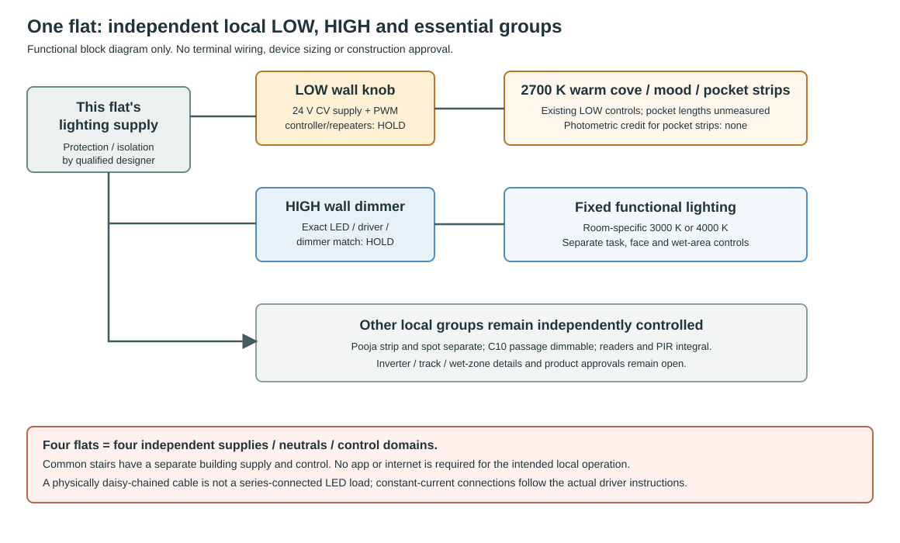
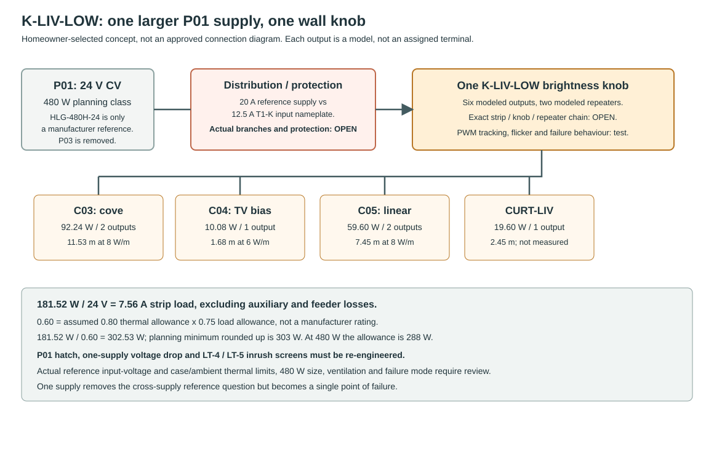
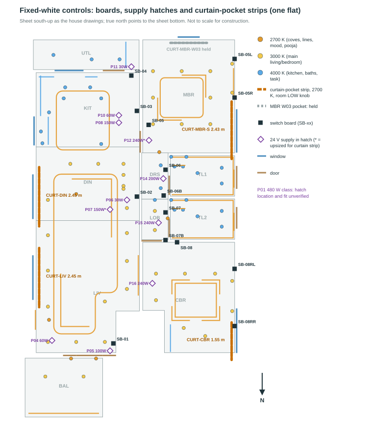
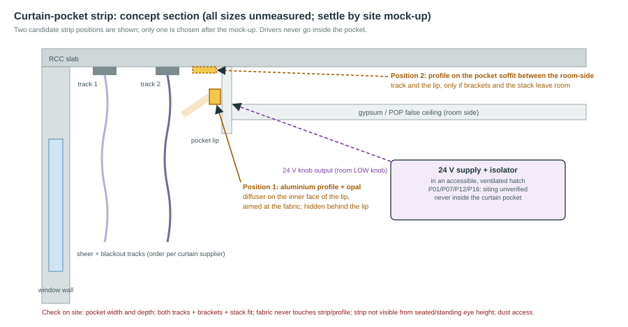
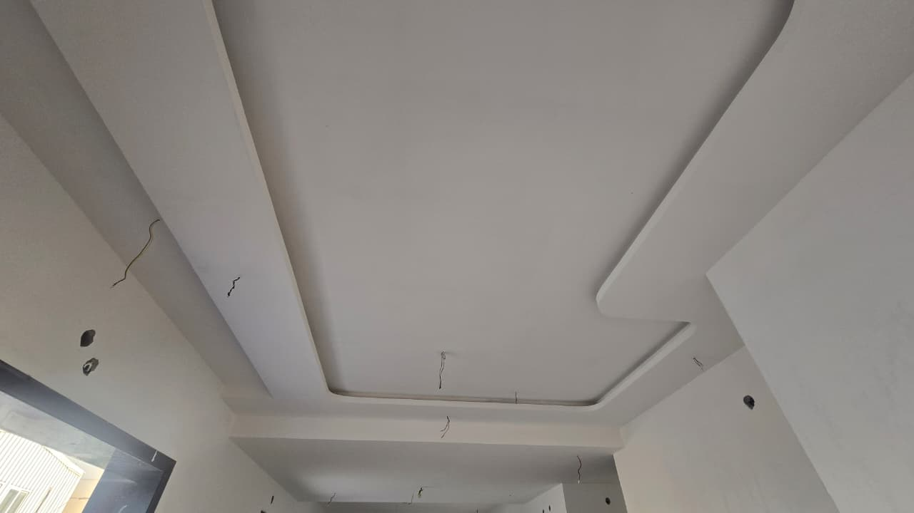
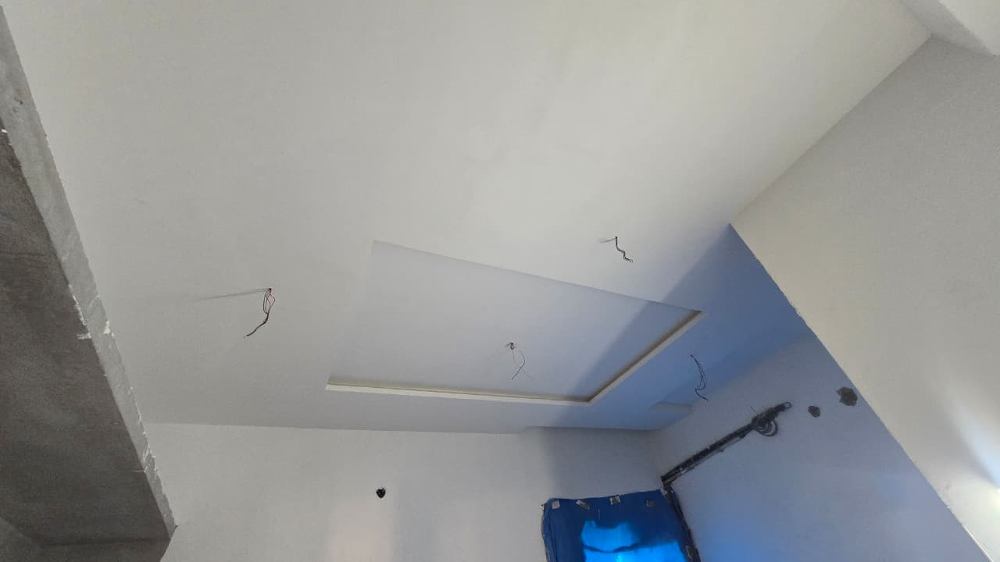

# Electrical and wall-control handoff

**Review and quotation only - not for ordering, wiring or construction.** Working assumption: four storeys with one modelled 2BHK flat per floor (four flat schedules total). All quantities below are for **one flat** unless stated otherwise; confirm the actual floor and flat count and variations on site.

**Master SHA-256:** `1fa6b0fa040d2f0c81427d9277eb9b98f23170b7f63446f287000d58fc9002a4`. The prior master has a verified wardrobe reference; the later reviewed CCT-only proposal changes selected mains to 4000 K without moving fittings or changing modeled lumens.

**Release gates:** construction release **false**; product approval **false**; exact lighting/driver/control chain proven **false**. The electrician, engineer and suppliers must close the site, safety, product and performance holds before a separate construction release.

The homeowner selected fixed colour temperatures, four warm curtain-pocket strips on the existing room LOW controls, CBR H1-H6 for active review, and one larger living LOW supply. These decisions do **not** release dimensions, loads, fittings, electrical protection or installation. Wardrobe OPT-E and the master-bedroom split are separate interior decisions; the split is in principle only. The subsequently added wardrobe-interior reference remains provisional; no new wardrobe lighting has been selected or costed. Pooja display uses small idols with a framed picture; lighting geometry, clearances and support are still held.

## What this pack contains

* **104 base fixtures / 47 base circuits** plus four selected curtain-pocket strips and four circuit records = **108 fittings / 51 circuits**. Four added strips total **8.88 m / 71.04 W**, but their lengths are derived and **unmeasured**; they receive no lux credit.
* **21 single-colour brightness knobs**, 38 modeled outputs, three modeled repeaters/amplifiers, ten mains-dimmer groups on procurement hold, **12 planned 24 V supplies / 1,980 W total nameplate**, and one separate 48 V track driver per flat. Device counts and reference ratings are concepts, not approved equipment.
* Coves, decorative/mood strips and the selected pockets are fixed **2700 K**. Other lights use fixed 3000 K or 4000 K according to their room and use. LOW and HIGH have independent local controls; a single knob does not change colour temperature. App, cloud and wireless operation are not required.
* The earlier fixed-white photometric package reported **82/82** checks on its verified source input. That historical result has **not** been rerun on this latest master; retained calculations exclude the four added pocket strips.

The full machine-readable schedules are in `schedules/`. `circuit-schedule.csv` lists 51 groups; `wall-control-schedule.csv` lists 31 wall dimmers/knobs; the six fitting controls and eight conceptual switch modules are separate. See `source-index.md` and `wholesale-rfq.md` for exact sources and purchasing requirements.

## Block diagrams and floor reference

The floor illustration is an indicative overlay, **not** a scaled construction drawing. The larger P01 supply's location and hatch are intentionally not plotted: its size, weight, heat and access must be surveyed. Other hatches are proposals only. CBR H1-H6 are released for review, not for unmeasured construction. True north is shown on the sheet.

The four chosen strips use the respective room's existing LOW knob, with no new knob. `CURT-MBR-W03` remains excluded and held. Two possible profile positions are illustrated; choose neither until a measured mock-up confirms track/bracket clearance, diffuser, hidden sightline, return and service access. Do not locate a driver in the curtain pocket.

The source master links the same hall photo to LIV and DIN and a children's-room photo to CBR. No site photo is individually linked to `CURT-MBR-S`; verify that selected location on site. Neither photo is scaled or proves a pocket dimension.

*Hall reference linked to the living and dining pockets; not a measured drawing.*

*Children's-room reference linked to the CBR pocket; not a measured drawing.*

## Living LOW supply and controls

| Group | Planned strip length | Assumed W/m | Strip W | Modeled outputs |
|---|---:|---:|---:|---:|
| C03 living cove | 11.53 m | 8 | 92.24 | 2 |
| C04 TV bias | 1.68 m | 6 | 10.08 | 1 |
| C05 linear | 7.45 m | 8 | 59.60 | 2 |
| X-CURT-LIV | 2.45 m, unmeasured | 8 | 19.60 | 1 |
| **Total** | | | **181.52** | **6** |

Retain **P01** as the one 24 V constant-voltage supply and remove P03; the four groups remain on **K-LIV-LOW**, with **two modeled repeaters** and no extra wall knob. The supply is preferably **480 W class**, with Mean Well HLG-480H-24 cited as a manufacturer reference only. The exact SKU, suffix, supplier and compatibility are not approved.

At nominal 24 V the strip load is approximately **7.56 A**, excluding unquantified controller/repeater consumption, cable losses and tolerances. The old project allowance is **0.60 = 0.80 assumed thermal factor x 0.75 assumed loading factor**; neither factor is a manufacturer-specific derating. Thus 181.52 / 0.60 = 302.53 W, rounded up to **303 W**. A 480 W nameplate gives 288 W at that planning factor. The previous additional 90% cap was a separate project reserve, not another manufacturer rule; do not silently stack it. The selected unit's actual input and temperature curves, mounted `tc` temperature, measured loads and any separately justified reserve govern the professional design.

The reference 480 W unit can supply **20 A** while the T1-K candidate has a **12.5 A input nameplate**. This does not mean 20 A is forced through a healthy load, but faults, branch protection, conductors, connectors, controller and repeaters must be engineered to their real ratings. No direct connection is approved. A single supply avoids the old two-supply common-reference question but is a single point of failure; agree an accessible replacement strategy.

The manufacturer's HLG-480H-24 datasheet states **262 x 125 x 43.8 mm**, approximately **2.8 kg**, and 90-305 V AC input subject to its curves. Its ambient-temperature graph shows 100% load through 60 C above 230 V AC, and through 50 C at 110 V AC, with both curves reducing to about 60% at 65 C. Its input graph shows 80% at 90 V AC and 100% from 110 V AC; maximum stated case temperature is 90 C. These graph conditions are not a guarantee of combined worst-case performance: confirm actual input, mounting and measured `tc` with the manufacturer. Check actual support, ventilation and access. Old P01/P03 living voltage-drop results are **invalid for this changed distribution**. The LT-4 and LT-5 supply membership and inrush screens are also **open / not revalidated**.

The HLG-480H specification lists a maximum of 2 units on a B16 or 3 on a C16 at 230 V, while the retained manufacturer installation lookup states 1 and 2. Reconcile this conflict with the manufacturer for the exact breaker, mixed supply group, ambient and installation. Neither table is a breaker selection.

## Circuit schedule

Loads are modeled LED-side or fixture allowances, **not measured AC input**, installed wattage or breaker settings. Fixture and CCT detail is in `schedules/fixtures.csv`; a group name is not proof of compatible products. Status of every product remains on hold.

| Circuit | Room / lane | Fixture IDs | Control / supply | W |
| --- | --- | --- | --- | --- |
| C01 | LIV / HIGH | LIV-H1, LIV-H2, LIV-H3, LIV-H4, LIV-H5 | D-C01 / mains / integral | 40 |
| C02 | LIV / HIGH | LIV-H6, LIV-H7, LIV-H8, LIV-H9, LIV-H10 | D-C02 / mains / integral | 40 |
| C03 | LIV / COVE | LIV-L1 | K-LIV-LOW / P01 | 92.24 |
| C04 | LIV / MOOD | LIV-L2 | K-LIV-LOW / P01 | 10.08 |
| C05 | DIN; LIV / LINE | LIV-X1, LIV-X2, DIN-X1 | K-LIV-LOW / P01 | 59.6 |
| C06A | LIV / ACCENT | LIV-P1 | K-LIV-POOJA-STRIP / P04 | 21.72 |
| C06B | LIV / ACCENT | LIV-P2 | K-LIV-POOJA-SPOT / P04 | 6 |
| C07 | BAL / HIGH | BAL-H1, BAL-H2 | K-BAL-HIGH / P05 | 12 |
| C08 | BAL / MOOD | BAL-L1, BAL-L2, BAL-L3 | K-BAL-LOW / P05 | 26.65 |
| C09 | DIN / HIGH | DIN-H1, DIN-H2, DIN-H3 | D-C09 / mains / integral | 30 |
| C10 | DIN / HIGH | DIN-H6 | K-DIN-PASSAGE / P06 | 8 |
| C11 | DIN / MOOD | DIN-L1 | D-C11 / mains / integral | 12 |
| C12 | DIN / COVE | DIN-L2 | K-DIN-LOW / P07 | 49.68 |
| C13 | DIN / ACCENT | FW-T1, FW-T2, FW-T3, FW-T4 | D-C13 / mains / integral | 26 |
| C14 | KIT / HIGH | KIT-H1, KIT-H2, KIT-H3, KIT-H4 | D-C14 / mains / integral | 40 |
| C15 | KIT / HIGH | KIT-H5, KIT-H6, KIT-H7, KIT-H8 | D-C15 / mains / integral | 31 |
| C16 | KIT / TASK | KIT-T1, KIT-T2, KIT-T3, KIT-T4 | K-KIT-TASK / P10 | 31.8 |
| C17 | KIT / COVE | KIT-L1 | K-KIT-LOW / P08 | 70.56 |
| C18 | UTL / HIGH | UTL-H1, UTL-H2, UTL-H3 | D-C18 / mains / integral | 36 |
| C19 | UTL / TASK | UTL-T1 | K-UTL-TASK / P11 | 11 |
| C20 | MBR / HIGH | MBR-H1, MBR-H2, MBR-H3, MBR-H4, MBR-H5, MBR-H6, MBR-H7, MBR-H8 | D-C20 / mains / integral | 48 |
| C21 | MBR / COVE | MBR-L1 | K-MBR-LOW / P12 | 52.24 |
| C22 | MBR / LINE | MBR-X1, MBR-X2 | K-MBR-LOW / P12 | 30.88 |
| C23 | MBR / MOOD | MBR-L2 | K-MBR-LOW / P12 | 7.68 |
| C24 | MBR / NIGHT | MBR-N1 | INTEGRAL / mains / integral | 1 |
| C25 | MBR / READ | MBR-R1 | INTEGRAL / mains / integral | 3 |
| C26 | MBR / READ | MBR-R2 | INTEGRAL / mains / integral | 3 |
| C27 | DRS / HIGH | DRS-H1, DRS-H2 | K-DRS-HIGH / P14 | 14 |
| C28 | TL1 / HIGH | TL1-G1, TL1-G2, TL1-G3 | K-TL1-HIGH / P14 | 27 |
| C29A | TL1 / MIRROR | TL1-M1, TL1-M2 | K-TL1-HIGH / P14 | 16 |
| C29B | TL1 / FACE | TL1-F1, TL1-F2 | K-TL1-FACE / P14 | 10 |
| C30A | TL1 / PERIM | TL1-L1 | K-TL1-LOW / P14 | 31.87 |
| C30B | TL1 / MOOD | TL1-L2, TL1-L3 | K-TL1-LOW / P14 | 7.25 |
| C31 | LOB / HIGH | LOB-H1, LOB-H2 | K-LOB / P15 | 14 |
| C32 | LOB / MIRROR | LOB-F1 | K-LOB / P15 | 10 |
| C33 | LOB / NIGHT | LOB-N1 | INTEGRAL / mains / integral | 1 |
| C34 | TL2 / HIGH | TL2-G1, TL2-G2, TL2-G3 | K-TL2-HIGH / P15 | 27 |
| C35A | TL2 / MIRROR | TL2-M1, TL2-M2 | K-TL2-HIGH / P15 | 16 |
| C35B | TL2 / FACE | TL2-F1, TL2-F2 | K-TL2-FACE / P15 | 10 |
| C36A | TL2 / PERIM | TL2-L1 | K-TL2-LOW / P15 | 31.87 |
| C36B | TL2 / MOOD | TL2-L2, TL2-L3 | K-TL2-LOW / P15 | 7.25 |
| C37 | CBR / HIGH | CBR-H1, CBR-H2, CBR-H3, CBR-H4, CBR-H5, CBR-H6 | D-C37 / mains / integral | 36 |
| C38 | CBR / STUDY | CBR-S1 | K-CBR-STUDY / P16 | 15.96 |
| C39 | CBR / COVE | CBR-L1 | K-CBR-LOW / P16 | 49.76 |
| C40 | CBR / LINE | CBR-X1, CBR-X2, CBR-X3, CBR-X4 | K-CBR-LOW / P16 | 42.88 |
| C41 | CBR / READ | CBR-R1 | INTEGRAL / mains / integral | 3 |
| C41b | CBR / READ | CBR-R2 | INTEGRAL / mains / integral | 3 |
| X-CURT-LIV | LIV / LOW / CURTAIN | CURT-LIV | K-LIV-LOW / P01 | 19.6 |
| X-CURT-DIN | DIN / LOW / CURTAIN | CURT-DIN | K-DIN-LOW / P07 | 19.6 |
| X-CURT-MBR-S | MBR / LOW / CURTAIN | CURT-MBR-S | K-MBR-LOW / P12 | 19.44 |
| X-CURT-CBR | CBR / LOW / CURTAIN | CURT-CBR | K-CBR-LOW / P16 | 12.4 |

## Wall controls and supplementary switches

Each listed wall control is local and brightness-only. The six integral reader/PIR controls are listed after the 31 wall controls; see the CSV for individual switch positions and the conceptual two-way/intermediate arrangements.

| Wall | Board | Controls these circuits | W |
| --- | --- | --- | --- |
| D-C01 | SB-01 | C01 | 40 |
| D-C02 | SB-01 | C02 | 40 |
| K-LIV-LOW | SB-01 | C03, C04, C05, X-CURT-LIV | 181.52 |
| K-LIV-POOJA-SPOT | SB-01 | C06B | 6 |
| K-LIV-POOJA-STRIP | SB-01 | C06A | 21.72 |
| K-BAL-HIGH | SB-01 | C07 | 12 |
| K-BAL-LOW | SB-01 | C08 | 26.65 |
| D-C09 | SB-02 | C09 | 30 |
| D-C11 | SB-02 | C11 | 12 |
| D-C13 | SB-02 | C13 | 26 |
| K-DIN-LOW | SB-02 | C12, X-CURT-DIN | 69.28 |
| K-DIN-PASSAGE | SB-02 | C10 | 8 |
| D-C14 | SB-03 | C14 | 40 |
| D-C15 | SB-03 | C15 | 31 |
| K-KIT-LOW | SB-03 | C17 | 70.56 |
| K-KIT-TASK | SB-03 | C16 | 31.8 |
| D-C18 | SB-04 | C18 | 36 |
| K-UTL-TASK | SB-04 | C19 | 11 |
| D-C20 | SB-05 | C20 | 48 |
| K-MBR-LOW | SB-05 | C21, C22, C23, X-CURT-MBR-S | 110.24 |
| K-DRS-HIGH | SB-06 | C27 | 14 |
| K-TL1-FACE | SB-06B | C29B | 10 |
| K-TL1-HIGH | SB-06B | C28, C29A | 43 |
| K-TL1-LOW | SB-06B | C30A, C30B | 39.12 |
| K-LOB | SB-07 | C31, C32 | 24 |
| K-TL2-FACE | SB-07B | C35B | 10 |
| K-TL2-HIGH | SB-07B | C34, C35A | 43 |
| K-TL2-LOW | SB-07B | C36A, C36B | 39.12 |
| D-C37 | SB-08 | C37 | 36 |
| K-CBR-LOW | SB-08 | C39, C40, X-CURT-CBR | 105.04 |
| K-CBR-STUDY | SB-08 | C38 | 15.96 |

| Fitting control | Board | Device |
| --- | --- | --- |
| C24 | SB-05 | PIR night step light, brightness set on the fitting |
| C25 | SB-05L | reading light with integral dimmer (on the fitting) |
| C26 | SB-05R | reading light with integral dimmer (on the fitting) |
| C33 | SB-07 | PIR night step light, brightness set on the fitting |
| C41 | SB-08RL | reading light with integral dimmer (on the fitting) |
| C41b | SB-08RR | reading light with integral dimmer (on the fitting) |

Pooja C06A strip and C06B spot **must remain separately controllable**: dimming a spot does not eliminate a worshipper's shadow. C10 passage keeps its dimmer. Bathroom face controls remain separate; relevant product/IP and electrical zones need professional approval.

## Power supply and distribution review

These are **planning classes**, not procurement selections. The nameplate allowance is not a measured site capacity. Accessible, ventilated and safely isolated service locations, thermal mounting, inrush, protection and local replacement are mandatory professional design checks. Each flat's circuits, neutrals, low-voltage return and control power stay separate. Common stairs/landings use a separate building supply/control.

| 24 V supply | Model W | Nameplate W | Circuit groups |
| --- | --- | --- | --- |
| P01 | 181.52 | 480 | C03, C04, C05, X-CURT-LIV |
| P04 | 27.72 | 60 | C06A, C06B |
| P05 | 38.65 | 100 | C07, C08 |
| P06 | 8 | 30 | C10 |
| P07 | 69.28 | 150 | C12, X-CURT-DIN |
| P08 | 70.56 | 150 | C17 |
| P10 | 31.8 | 60 | C16 |
| P11 | 11 | 30 | C19 |
| P12 | 110.24 | 240 | C21, C22, C23, X-CURT-MBR-S |
| P14 | 106.12 | 200 | C27, C28, C29A, C29B, C30A, C30B |
| P15 | 116.12 | 240 | C31, C32, C34, C35A, C35B, C36A, C36B |
| P16 | 121 | 240 | C38, C39, C40, X-CURT-CBR |

| Concept group | Members | Model W | Inrush / protection status |
| --- | --- | --- | --- |
| LT-1 | C01, C02, C09, C11, C13, C14, C15, C18 | 255 | OPEN - historical reference screen is not approval |
| LT-2 | C20, C24, C25, C26, C33, C37, C41, C41b | 98 | OPEN - historical reference screen is not approval |
| LT-3 | P06, P14, P15, P16 | 351.24 | OPEN - historical reference screen is not approval |
| LT-4 | P01, P07 | 250.8 | HOLD - previous screen invalid |
| LT-5 | P04, P05 | 66.37 | HOLD - previous screen invalid |
| LT-6 | P08, P10, P11 | 113.36 | OPEN - historical reference screen is not approval |
| LT-7 | P12 | 110.24 | OPEN - historical reference screen is not approval |

The distribution groups are conceptual allocation, not an instruction to install particular breakers, cable sizes or isolators. LT-4/LT-5 no longer inherit their previous PASS; all other historical inrush screens remain indicative only and do not replace protective coordination. A physically daisy-chained cable can serve loads electrically in parallel. Never infer a constant-current LED-module connection from a constant-voltage strip concept; follow the selected driver's instructions.

## Voltage drop, heat and other site holds

* **Living LOW:** the previous split-P01/P03 feeder and branch voltage drops do not validate the one-supply distribution. Recalculate with the actual location, route, branch currents, temperature, terminations, real copper area, strip end-to-end drop, repeater losses and protection. Split-feed/injection is a design option only when the exact strip and controller maker permits it.
* **Children's room:** previous S1 assumptions gave C39 **3.3%** and C40 **3.6%**, both **MARGINAL**. The shared P16-to-SB-08 feed had a **2.5 mm2 candidate** for its assumed target; actual route, load, protection and current standards need the electrician's design. Do not treat 2.5 mm2 as an installation instruction. The measured strip and route may change both results.
* **Curtains and joinery:** measure all pocket widths/depths, returns, bracket and curtain-stack clearance; confirm the strip is hidden from seated and standing eye height. The section drawings and the 0.30 m return are assumptions. Seek the approved aluminium profile and diffuser; a site mock-up decides visibility and colour.
* **Bathroom / balcony / utility:** the schedule's IP values are project targets, not certification or proof of zone suitability. Confirm complete luminaire, connector, driver location, ingress rating, corrosion/condensation and all current wet-zone requirements with the qualified electrician.
* **Service:** protect and label cables, use manufacturer-approved aluminium heat-sinking, avoid enclosed hot drivers, and allow accessible isolation and replacement. Confirm power-on memory, mains-voltage range, surge coordination, inrush, power-factor/VA, thermal limits, low-level flicker and fan/strobing interaction.
* **Pooja:** the chosen display arrangement is conceptual. Preserve independent strip and spot controls and verify idol/picture positions, shadow, shelf/support load, heat and fire clearance at site.

## Sampling and handover gates

1. Obtain written specifications and India order codes for each proposed luminaire or strip, its exact LED driver / CV supply, wall dimmer, repeater, profile and accessories. The supplier must explicitly document their combined dimming and allowable group size; a shared brand or voltage label is insufficient.
2. Bench-test representative shortest/longest strips and the intended minimum/maximum group sizes: smooth low and full output, colour match, flicker, hum, cold starts, OFF glow, power-loss memory, actual power and temperature, repeater tracking and switch-on surges. Check strobing near fans and filmed scenes.
3. Measure the four curtain pockets and site routes; record product-specific voltage drop, dimmer box fit, protected branch limits, mounting temperatures, P16 C39/C40 outcome and wet-area approvals. Do not accept the previous living-drop or LT-4/LT-5 screens.
4. Collect Hyderabad availability, GST, delivery, labour, warranty, importer/service address, spare parts and replacement lead time for the exact order codes. A quote must separate optional upgrades and all exclusions.
5. Qualified professionals document current applicable standards, supply segregation, earthing, isolation, overcurrent / residual-current / surge coordination, wet zones, inverter and common-area arrangements. The homeowner reviews the physical mock-up and appearance; a later explicit construction release is still required.

## Budget and open decisions

The older **S1 two-supply** allowance was INR **312,513-769,083 per flat** and INR **1,250,052-3,076,332 for four flats**, including a 12% contingency and some modeled point/profile labour. It excluded GST, freight, curtain tracks/carpentry and electrical DB, protection and site works. Supply-size changes within a broad BoM class were assigned zero incremental cost only as an unverified assumption. It was an allowance, not a quote, and **does not include the one-480 W-supply revision**. No verified current installed price or supply-cost delta exists; request the itemised RFQ before treating any figure as the final budget.

**Homeowner review:** approve measured pocket samples and sightlines, lighting colour/finish samples, physical knob positions and the final quoted budget after supplier and professional checks. No extra curtain knob is requested.

**Professional / supplier work:** close exact chains, product ratings and local support; redesign living distribution and inrush; resolve P16/C39/C40 and actual routes; validate hatch fit/thermal management, zones/protection/segregation and the retained pooja and CBR site holds. These are engineering checks, not homeowner substitutes for technical approval.
